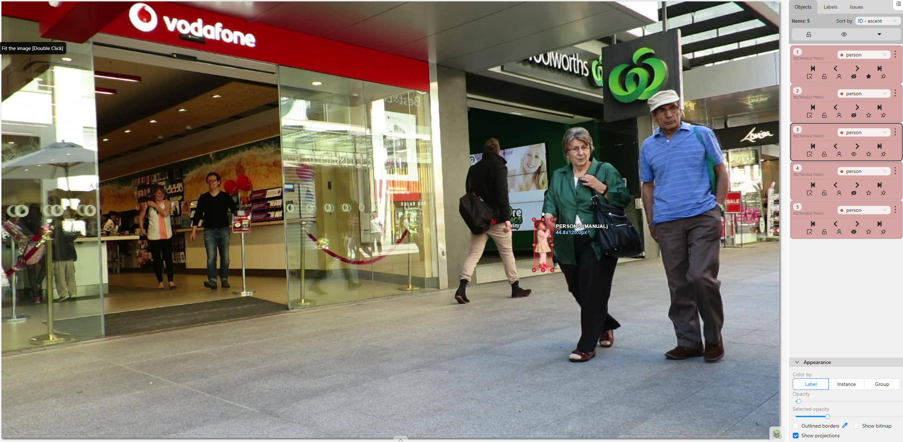
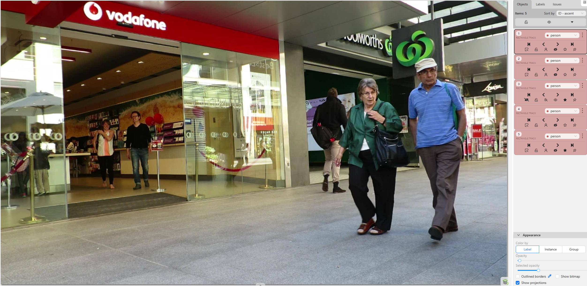
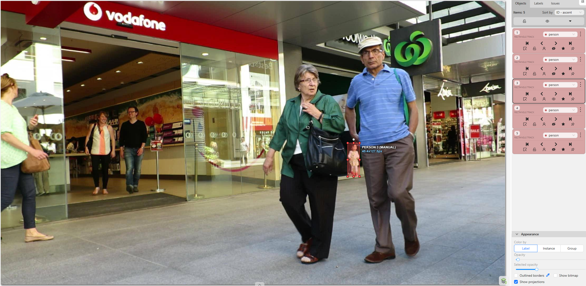

# Báo cáo cá nhân — HoVaTen-MSSV

Đổi tên file theo quy tắc `MSSV_HoTen.md`. Ví dụ: `20241234_NguyenVanAn.md`.

Đoạn video: MOT17-09, 150 frame (frame 1–150), nguồn MOTChallenge, giấy phép CC BY-NC-SA 3.0.

## 0. Thông tin học viên

- Họ tên: Doãn Tùng Lâm
- MSSV: 2A202603227
- Mã đề (A/B/C): A
- Email: 26ai.lamdt2@vinuni.edu.vn
- Link repository: https://github.com/doantunglam/K5-L2-DAY05-DoanTungLam-2A202603227-MOTTracking
- Giờ bắt đầu: 16h00
- Giờ kết thúc: 23h00

## 1. Xem trước đoạn video (CP0)

Ghi **trước khi vẽ**, mỗi người một dòng.

| Mã  | Frame xuất hiện | Frame cuối thấy được | Rẽ / dừng / đổi tốc độ ở frame | Bị che ở frame           | Ghi chú |
| --- | --------------- | -------------------- | ------------------------------ | ------------------------ | ------- |
| P1  | 0               | 149                  | Không có                       | Không bị che             | -       |
| P2  | 0               | 149                  | Không có                       | Không bị che             | -       |
| P3  | 0               | 146                  | Dừng ở `frame 38`              | `106 - 139`, `143 - 149` | -       |
| P4  | 0               | 149                  | Không có Rẽ ở `frame 103`      | `60 - 70`                | -       |
| P5  | 60              | 149                  | Không có                       | `0 - 17`, `26 - 53`      | -       |

## 2. Keyframe và thời gian (CP1, CP4)

Số keyframe lấy từ kết quả `src/check_submission.py`.

| Mã       | Số keyframe | Keyframe ở frame                                                                                                                                                                                                                                                                          | Số frame có mặt | Keyframe / 100 frame | Thời gian (phút) | Chỗ khó                                                                                        |
| -------- | ----------: | ----------------------------------------------------------------------------------------------------------------------------------------------------------------------------------------------------------------------------------------------------------------------------------------- | --------------: | -------------------: | ---------------- | ---------------------------------------------------------------------------------------------- |
| P1       |          65 | 0, 1, 6, 7, 10, 16, 17, 20, 23, 27, 29, 30, 37, 40, 44, 45, 47, 49, 50, 54, 55, 57, 60, 62, 64, 67, 70, 73, 74, 77, 80, 84, 87, 90, 93, 94, 97, 99, 100, 104, 105, 106, 108, 110, 112, 113, 114, 117, 119, 120, 121, 124, 126, 127, 130, 131, 134, 137, 139, 140, 142, 144, 147, 148, 149 |             150 |                 43.3 | 11                | Có mặt suốt 150 frame, không bị che nhưng box trôi nhanh nên phải chỉnh dày                    |
| P2       |          65 | 0, 2, 7, 8, 10, 17, 20, 26, 27, 30, 32, 35, 37, 40, 43, 47, 50, 54, 57, 60, 64, 67, 70, 71, 73, 75, 77, 79, 80, 83, 87, 89, 90, 91, 92, 93, 94, 96, 97, 98, 100, 102, 104, 107, 109, 110, 112, 114, 117, 119, 120, 122, 126, 127, 129, 130, 131, 132, 136, 137, 140, 142, 146, 147, 149   |             150 |                 43.3 | 11                | Có mặt suốt 150 frame, không bị che nhưng box trôi nhanh nên phải chỉnh dày                    |
| P3       |          19 | 0, 10, 20, 30, 40, 50, 60, 70, 80, 90, 100, 106, 107, 109, 110, 136, 139, 140, 143                                                                                                                                                                                                        |             122 |                 15.6 | 6                | Dừng ở frame 38; bị che 13 frame, khuất hẳn frame 111–135 (25 frame), ra khỏi cảnh ở frame 146 |
| P4       |          52 | 0, 10, 18, 20, 23, 24, 26, 27, 30, 50, 53, 54, 55, 58, 59, 60, 64, 69, 70, 74, 75, 77, 78, 79, 80, 83, 84, 85, 87, 89, 90, 91, 92, 94, 96, 99, 100, 102, 104, 108, 110, 111, 114, 120, 124, 129, 130, 134, 140, 144, 147, 149                                                             |             140 |                 37.1 | 6                | Bị che 40 frame, khuất hẳn frame 40–49 rồi hiện lại                                            |
| P5       |          18 | 60, 70, 74, 80, 84, 90, 94, 100, 104, 110, 114, 120, 124, 130, 134, 140, 144, 149                                                                                                                                                                                                         |              90 |                 20.0 | 8                | Vào muộn (frame 60), bị che 10 frame đầu                                                       |
| **Tổng** |         219 |                                                                                                                                                                                                                                                                                           |             652 |                 33.6 | 42                |                                                                                                |

Keyframe / 100 frame của cả bài = tổng keyframe ÷ tổng số frame có mặt × 100 = 219 ÷ 652 × 100 ≈ **33,6**.

Bạn đặt keyframe nhiều nhất ở người nào? Vì sao (người đó rẽ, dừng, lại gần camera hay bị che)?

- P1 và P2 nhiều nhất, mỗi người 65 keyframe (43,3 keyframe / 100 frame), gấp hơn ba lần P5 (18 keyframe, 20,0) và P3 (19 keyframe, 15,6). Hai người này có mặt trọn 150 frame và không bị che, nên keyframe dày không phải do che khuất mà do box của họ trôi nhanh khi nội suy (đi, đổi hướng hoặc đổi kích thước theo khoảng cách tới camera), nên tôi phải chỉnh lại box sau mỗi 2–5 frame

## 3. Đoạn bị che (CP2)

Người bị che: `P3`

Frame ghi theo số frame CVAT (bắt đầu từ 0), cùng cách ghi với mục 1.

| Mốc                                      | Frame |
| ---------------------------------------- | ----: |
| Bắt đầu bị che một phần (bật `occluded`) |   106 |
| Mất hẳn (bật `outside`)                  |   111 |
| Hiện lại (tắt `outside`)                 |   136 |
| Thấy rõ trở lại (tắt `occluded`)         |   140 |

- Thời gian khuất hẳn: **25 frame (frame 111–135) ≈ 0,83** giây (30 fps).
- Quyết định: **giữ cùng ID** (không tạo track mới).
- Lý do (trả lời 3 câu: khuất bao lâu so với 60 frame, ngoại hình có khớp, chỗ hiện lại có đúng hướng và tốc độ):
  1. Khuất hẳn 25 frame, ngắn hơn ngưỡng 60 frame (2 giây), nên theo quy ước của lớp đủ điều kiện giữ cùng ID.
  2. Ngoại hình khớp: cùng một người, kích thước box trước và sau đoạn khuất gần như nhau (khoảng 44×125 px ở frame 110 so với 45×128 px ở frame 140).
  3. Chỗ hiện lại đúng vị trí: người này đang đứng yên (đã dừng từ frame 38), tâm box ở frame 110 là (1338, 602) và ở frame 140 là (1343, 605), chỉ lệch vài pixel, nên đúng hướng và tốc độ (gần như bằng 0). Không có người nào khác xuất hiện ở chỗ đó trong lúc khuất.

Ảnh chụp màn hình:





## 4. Tự review ID (CP3)

Lượt 1 theo người (đi ngược từ frame 149 về 0 trên CVAT), lượt 2 theo cảnh (nhảy 10 frame). Ít nhất 3 dòng; không có lỗi thì ghi một dòng "đã kiểm hai lượt, không lỗi".

Loại lỗi dùng đúng một trong 7 mã: `id_switch`, `fragmentation`, `lost`, `merge`, `false_track`, `drift`, `flag`.

| Frame | Mã người | Loại lỗi | Mô tả một câu | Phát hiện ở lượt | Đã sửa? |
| ----: | -------- | -------- | ------------- | ---------------- | ------- |
|       |          |          |               |                  |         |
|       |          |          |               |                  |         |
|       |          |          |               |                  |         |

Tổng hợp số lỗi theo loại:

| `id_switch` | `fragmentation` | `lost` | `merge` | `false_track` | `drift` | `flag` |
| ----------: | --------------: | -----: | ------: | ------------: | ------: | -----: |
|             |                 |        |         |               |         |        |

Lỗi nào chỉ lượt 2 (theo cảnh) mới thấy, lượt 1 (theo người) không thấy? Vì sao?

- đã kiểm hai lượt, không lỗi

## 5. File xuất và kết quả tự kiểm (CP4)

| Kiểm tra                                                  | Kết quả    |
| --------------------------------------------------------- | ---------- |
| Tên file MOT 1.1                                          | Có         |
| Tên file CVAT for video 1.1                               | Có         |
| Số track ID khác nhau trong `gt/gt.txt` (phải là 5)       | 5 track ID |
| Frame `outside` không có dòng trong `gt.txt` (đúng / sai) | Đúng       |
| Job đã completed trên CVAT máy cá nhân                    | Có         |

Dán phần tóm tắt in ra từ `src/check_submission.py`:

```text
Số frame in theo CVAT (bắt đầu từ 0). Trong gt.txt, frame_id = frame CVAT + 1.

=== File MOT 1.1: DoanTungLam_mot.zip ===
  Số track ID: 5   |   Tổng số box: 652
  [OK]        Đúng 5 track ID.

  Track | Frame có mặt | Số frame | Đoạn vắng (outside)
      1 |   0–149      |      150 | -
      2 |   0–149      |      150 | -
      3 |   0–146      |      122 | 111–135
      4 |   0–149      |      140 | 40–49
      5 |  60–149      |       90 | -


=== File CVAT for video 1.1: DoanTungLam_cvat_video.zip ===

  Track | Nhãn   | Frame thấy | Keyframe | KF/100 frame | Frame occluded | Lần bật outside
      0 | person |        150 |       65 |         43.3 |              0 |               0
      1 | person |        150 |       65 |         43.3 |              0 |               0
      2 | person |        122 |       19 |         15.6 |             13 |               2
      3 | person |         90 |       18 |         20.0 |             10 |               0
      4 | person |        140 |       52 |         37.1 |             40 |               1

  Tổng: 219 keyframe / 652 frame có mặt = 33.6 keyframe / 100 frame
  [OK]        Đọc được 5 track từ annotations.xml.

=== Tóm tắt ===
  Lỗi: 0   |   Cảnh báo: 0
  Đạt. Dán phần tóm tắt này vào báo cáo mục 5.
```

## 6. Ba câu kết

1. Nếu được gán lại, bạn sẽ đặt keyframe khác ở đâu? Vì sao?

   - Tôi sẽ đặt thưa hơn, chỉ ở chỗ đổi hướng, đổi tốc độ hoặc box lệch rõ. P1 và P2 mỗi người 65 keyframe là quá dày. P3 đứng yên từ frame 38 nên chỉ cần keyframe ở frame đầu, frame dừng, quanh đoạn che (106–110, 136–143) và frame cuối.

2. Có chỗ nào bạn không chắc "cùng ID hay ID mới"? Bạn đã quyết định và ghi chú thế nào?

   - P3 sau khi khuất hẳn 25 frame (111–135). Tôi giữ cùng ID vì ngắn hơn ngưỡng 60 frame và người này hiện lại đúng chỗ cũ với box tương tự. Lý do ghi ở mục 3.

3. Một lỗi ID trong job của bạn (nếu không còn sót, chọn lỗi đã sửa) có thể làm xe tự lái dự đoán sai chuyển động của người đó như thế nào? Lỗi đó ảnh hưởng MOTA hay IDF1 nhiều hơn?

   - Job không còn lỗi ID, nên tôi lấy tình huống có thể xảy ra: P3 hiện lại ở frame 136 với ID mới. Xe coi đó là người mới, mất lịch sử vận tốc và hướng nên dự đoán chuyển động sai. Lỗi này ảnh hưởng IDF1 nhiều hơn MOTA, vì MOTA chỉ tính một lỗi đổi ID, còn IDF1 tính sai danh tính cho cả phần track còn lại.

## Bonus (nếu làm)

### B1 — Hai người đi sát

...

### B2 — So cách đặt keyframe

| Cách đặt           | Số keyframe | Frame trôi nhất | Ghi chú |
| ------------------ | ----------: | --------------: | ------- |
| Đều mỗi 30 frame   |             |                 |         |
| Theo chỗ đổi hướng |             |                 |         |

...

### B3 — So với tracker có sẵn

| Frame | Mã người | Tracker làm gì | Nhãn của bạn | Giải thích (đoán rồi sửa / ghép IoU / box score thấp / ngoại hình) |
| ----: | -------- | -------------- | ------------ | ------------------------------------------------------------------ |
|       |          |                |              |                                                                    |
|       |          |                |              |                                                                    |

## 7. Tài liệu tham khảo và công cụ AI đã dùng

  - Claude, Gemini cho tra cứu thông tin, cách xử lý những trường hợp gây khó hiểu
